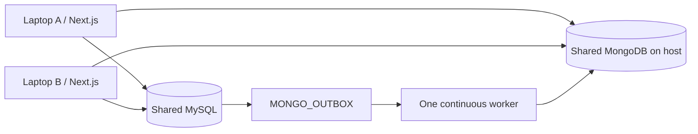

# Shared team database — Windows setup

Both developers run Next.js locally, connecting to **one MySQL instance/database and one authenticated MongoDB instance/database on the host over ZeroTier**. There is no replication between separate laptop databases. Follow [local MongoDB setup](LOCAL_MONGODB_SETUP.md) for authentication, migration and private port 27017 access. Atlas is an optional alternative.



## Audit and what changes

Remote MySQL already works with MYSQL_HOST, MYSQL_PORT, MYSQL_USER, MYSQL_PASSWORD and MYSQL_DATABASE. The web pool and CLI now use the same option factory, `lib/mysql-config.mjs`; the reference seed uses the CLI connection helper. No alternate connection-string/configuration system was added. MongoDB already reads MONGODB_URI and MONGODB_DATABASE. App authentication, matching, claims, migrations and outbox remain intact.

Choose the host containing the authoritative existing SQL data. If the other laptop has unique records, stop and plan a reviewed backup/import with identity/outbox ID reconciliation; do not blindly merge its tables into the shared database or copy documents between independently numbered SQL datasets. This setup does not migrate or reconcile two divergent SQL histories. If both old local instances already wrote to Atlas, identical numeric report/outbox IDs may have represented different entities. A zero-orphan count checks ID existence, not whether private document contents were historically overwritten; review backups and ownership before reconciling such data. Back up the chosen server before a planned migration. Existing application data is preserved by setup; do not reset either database or run initialization on a second server expecting automatic synchronization.

All addresses/passwords below are placeholders. Replace them locally; do not paste secrets into Git/chat. Each developer keeps their own ignored .env.local. **No networking commands in this guide are executed automatically by the app or scripts.**

## A. Host laptop: private networking and MySQL

### 1. Join a private network

Use an authorized private ZeroTier network on both machines, or a trusted LAN. Authorize both devices in the network owner's ZeroTier console. With the installed ZeroTier CLI on PATH, Administrator PowerShell can run:

```powershell
zerotier-cli join <PRIVATE_NETWORK_ID>
zerotier-cli listnetworks
Get-NetAdapter | Where-Object Name -Like '*ZeroTier*'
Get-NetIPAddress -AddressFamily IPv4 | Where-Object InterfaceAlias -Like '*ZeroTier*'
```

If the CLI is not on PATH, use its full installed executable/batch path or the ZeroTier tray application's Join Network action. For LAN, inspect `Get-NetIPConfiguration` instead. Use the **managed private adapter IPv4 address**, not a public WAN address. Keep host and teammate addresses stable. Do not create router port-forwarding rules for TCP 3306. The host must stay powered on, awake and connected while either developer uses its SQL data.

### 2. Confirm service and configuration file

```powershell
Get-Service MySQL80
# Administrator PowerShell, only if stopped:
Start-Service MySQL80
Get-CimInstance Win32_Service -Filter "Name='MySQL80'" | Select-Object Name,PathName
```

Use the service's actual name if different. Its PathName normally identifies the defaults file. A typical path is `C:\ProgramData\MySQL\MySQL Server 8.0\my.ini`. Back up and open the actual file as Administrator:

```powershell
$teamMyIni = '<ACTUAL_MY_INI_PATH>'
Copy-Item -LiteralPath $teamMyIni -Destination ($teamMyIni + '.before-team.bak')
notepad.exe $teamMyIni
```

Under `[mysqld]`, allow loopback and the host's private adapter only:

```ini
[mysqld]
port=3306
bind-address=127.0.0.1,<HOST_PRIVATE_ZEROTIER_OR_LAN_IPV4>
```

MySQL 8.0.13+ supports a comma-separated address list. Ensure the private adapter/address exists before restarting MySQL; otherwise binding may fail. Remove/comment an active `skip-networking` option if present. Do not add duplicate conflicting settings. Avoid wildcard bindings such as `0.0.0.0`, `*` or `::`, which can expose MySQL on other interfaces; a broad allow rule or router forwarding can then expose it publicly. This guide uses a specific private address instead. See [MySQL bind_address](https://dev.mysql.com/doc/refman/8.0/en/server-system-variables.html#sysvar_bind_address).

### 3. Create the dedicated project account

The `mysql` command assumes the installed MySQL client is on PATH; otherwise use `& '<PATH_TO_MYSQL_EXE>'` followed by the same switches.

Log into MySQL **locally on the host as its DBA**, using the password prompt. Do not give the DBA/root credentials to the teammate:

```powershell
mysql --host=127.0.0.1 --port=3306 --user=root --password
```

Run these SQL statements locally. Choose a strong project-account password privately; use the same chosen password for the explicit host variants. Do not use the literal placeholder or put a password in shell arguments.

```sql
CREATE DATABASE IF NOT EXISTS campus_lost_found
  CHARACTER SET utf8mb4 COLLATE utf8mb4_unicode_ci;

CREATE USER IF NOT EXISTS 'campus_app'@'localhost'
  IDENTIFIED BY '<CHOOSE_STRONG_PROJECT_PASSWORD_PRIVATELY>';
CREATE USER IF NOT EXISTS 'campus_app'@'127.0.0.1'
  IDENTIFIED BY '<SAME_PROJECT_PASSWORD>';
CREATE USER IF NOT EXISTS 'campus_app'@'<TEAMMATE_PRIVATE_IPV4>'
  IDENTIFIED BY '<SAME_PROJECT_PASSWORD>';

GRANT SELECT, INSERT, UPDATE, DELETE, EXECUTE,
  CREATE, ALTER, DROP, INDEX, REFERENCES,
  CREATE VIEW, SHOW VIEW, TRIGGER, CREATE ROUTINE, ALTER ROUTINE,
  CREATE TEMPORARY TABLES
  ON campus_lost_found.* TO 'campus_app'@'localhost';
GRANT SELECT, INSERT, UPDATE, DELETE, EXECUTE,
  CREATE, ALTER, DROP, INDEX, REFERENCES,
  CREATE VIEW, SHOW VIEW, TRIGGER, CREATE ROUTINE, ALTER ROUTINE,
  CREATE TEMPORARY TABLES
  ON campus_lost_found.* TO 'campus_app'@'127.0.0.1';
GRANT SELECT, INSERT, UPDATE, DELETE, EXECUTE,
  CREATE, ALTER, DROP, INDEX, REFERENCES,
  CREATE VIEW, SHOW VIEW, TRIGGER, CREATE ROUTINE, ALTER ROUTINE,
  CREATE TEMPORARY TABLES
  ON campus_lost_found.* TO 'campus_app'@'<TEAMMATE_PRIVATE_IPV4>';

SHOW GRANTS FOR 'campus_app'@'<TEAMMATE_PRIVATE_IPV4>';
```

These are **schema-scoped development privileges**, including repeatable setup/routine refresh and the academic evidence command. No global admin, FILE, GRANT OPTION, account-creation or replication privileges are needed. A deployment can separate migration privileges from runtime SELECT/INSERT/UPDATE/DELETE/EXECUTE; this development project uses one dedicated account. `IF NOT EXISTS` does not change an existing account password. If an account already exists, the DBA must verify its grants/password deliberately. CREATE USER/GRANT take effect without FLUSH PRIVILEGES. Host variants are normal MySQL account matching, not additional application accounts. See [MySQL account creation](https://dev.mysql.com/doc/refman/8.0/en/creating-accounts.html) and [privileges](https://dev.mysql.com/doc/refman/8.0/en/privileges-provided.html).

Prefer the teammate's exact private IP over `%`. If an operator deliberately uses `%` for temporary development convenience, it accepts matching account connections from any reachable source: the adapter binding and narrow firewall restrictions remain essential. Never use remote root access. If binary logging rejects function/trigger creation with error 1419/1418, ask the host DBA to review [stored-program logging restrictions](https://dev.mysql.com/doc/refman/8.0/en/stored-programs-logging.html). On a dedicated development server, the DBA may explicitly enable `SET GLOBAL log_bin_trust_function_creators=1` after reviewing that trust change. Do not grant SUPER/global administration to campus_app just to bypass it; the app never changes this server setting.

### 4. Scope the firewall rule and restart

Administrator PowerShell, with real values chosen from step 1:

```powershell
$teamHostIp = '<HOST_PRIVATE_IPV4>'
$teamPeerIp = '<TEAMMATE_PRIVATE_IPV4>'
$teamAdapter = '<EXACT_ZEROTIER_OR_TRUSTED_LAN_INTERFACE_ALIAS>'
New-NetFirewallRule -DisplayName 'Campus Lost Found MySQL - teammate only' `
  -Direction Inbound -Action Allow -Protocol TCP -LocalPort 3306 `
  -LocalAddress $teamHostIp -RemoteAddress $teamPeerIp `
  -InterfaceAlias $teamAdapter -Profile Any

Get-NetFirewallRule -Enabled True -Direction Inbound |
  Where-Object DisplayName -Like '*MySQL*' |
  Select-Object Name,DisplayName,Enabled,Profile
```

Profile Any here does not open all interfaces: the rule is constrained to the selected adapter, exact local IP, exact teammate IP and one port. Review existing installer/broad TCP 3306 allow rules; adding a narrow rule does not cancel a wider one. If an old rule is too broad, select its exact name and explicitly disable only that rule after review:

```powershell
Disable-NetFirewallRule -Name '<VERIFIED_OLD_BROAD_MYSQL_RULE_NAME>'
Restart-Service MySQL80
Get-Service MySQL80
Get-NetTCPConnection -State Listen -LocalPort 3306
Test-NetConnection -ComputerName 127.0.0.1 -Port 3306
mysql --host=127.0.0.1 --port=3306 --user=campus_app --password campus_lost_found
```

In the MySQL prompt: `SELECT 1, DATABASE(), VERSION();`. Keep Windows Firewall enabled. [Microsoft documents address/interface scope parameters](https://learn.microsoft.com/en-us/powershell/module/netsecurity/new-netfirewallrule).

## B. Both laptops: private configuration

Edit each existing `.env.local` in place. Never copy .env.example over an already configured file.

Host A:

```dotenv
MYSQL_HOST=127.0.0.1
MYSQL_PORT=3306
MYSQL_USER=campus_app
MYSQL_PASSWORD=<PROJECT_PASSWORD_SHARED_PRIVATELY>
MYSQL_DATABASE=campus_lost_found
MYSQL_SSL=false
MYSQL_SSL_CA_FILE=
```

Teammate B uses the same values, changing only the host address:

```dotenv
MYSQL_HOST=<HOST_PRIVATE_ZEROTIER_OR_LAN_IPV4>
MYSQL_PORT=3306
MYSQL_USER=campus_app
MYSQL_PASSWORD=<SAME_PROJECT_PASSWORD_SHARED_PRIVATELY>
MYSQL_DATABASE=campus_lost_found
MYSQL_SSL=false
MYSQL_SSL_CA_FILE=
```

Both must also select **the same shared MongoDB server, MONGODB_DATABASE and authSource**, privately. The host Mongo URI uses loopback; the teammate URI uses the host's ZeroTier IP, with the same database-scoped credentials. Enable MongoDB authorization and scope port 27017 to the teammate on the private adapter; see [local MongoDB setup](LOCAL_MONGODB_SETUP.md). Keep APP_BASE_URL local (normally http://localhost:3000) and choose a separate random SESSION_SECRET for each app instance; accounts are shared through SQL, not cookies. Restart each Next.js process after environment changes. If using Atlas instead, its access list must allow each laptop's actual outbound IP, and DNS must resolve its SRV/TXT records. Follow [ZeroTier networking guidance](https://docs.zerotier.com/routertips/).

### Teammate commands

```powershell
zerotier-cli listnetworks
$teamHostIp = '<HOST_PRIVATE_IPV4>'
Test-NetConnection -ComputerName $teamHostIp -Port 3306
mysql --host=$teamHostIp --port=3306 --user=campus_app --password campus_lost_found
# In the SQL prompt: SELECT 1, DATABASE(), VERSION(); then exit.

Set-Location '<YOUR_LOCAL_REPOSITORY_PATH>'
# After these changes are published, update a clean teammate checkout:
git pull --ff-only
notepad.exe .env.local
npm ci
npm run db:health
npm run db:health -- --team
npm run dev
```

A failed ping alone does not prove SQL is unavailable: ICMP may be blocked. Check TcpTestSucceeded on port 3306. If it fails, check the host is awake, both authorized private-network memberships, adapter/IP, bind setting, exact host-account entry and firewall rule. Do not disable the firewall or expose 3306 publicly to fix it.

## Initialize once and run normally

The host operator runs `npm run db:setup` and `npm run seed` against the selected shared development database. Preserve existing data. Run `npm run seed:admin` only if this shared database does not already have its intended provisioned Admin. Repeating the CLI preserves an existing active Admin, but do not create a different Admin on the second laptop expecting isolated accounts. Student/Staff provisioning and all application records are immediately shared through committed SQL; refresh the other browser to see new data. Document enrichment may lag until the outbox worker succeeds.

Both laptops run Next.js independently. Keep **one** continuous `npm run db:worker` on the host/trusted worker machine. Existing named locks, retries and idempotency also protect overlapping worker attempts; no second sync system is needed. Do not run db:setup/routine refresh concurrently from both laptops. Coordinate migrations while app traffic/workers are stopped, then restart them.

## Read-only health and comparison

```powershell
npm run db:health
npm run db:health -- --team
```

Full output masks host addresses and never emits MySQL/Mongo passwords, full Mongo URI, session secrets, account identities or password hashes. It checks SELECT 1, selected database/version, all 13 base tables, account counts, enabled accounts missing hashes, registered college/domain/ID policy, all four Mongo collections, the model's indexes/validators, queue age/failures and document-to-SQL orphan counts. Audit events remain historical. It performs no repair/deletion and suggests db:sync/db:worker for pending events.

Both developers compare the **fingerprint and database**, then migrations/counts in --team. The fingerprint hashes server UUID plus database, so host loopback and teammate private-IP connections match. Normal read privileges suffice. If UUID is unavailable, a labelled metadata fallback uses server hostname, server ID, server port, version and database. The fallback is weaker, changes after some upgrades, and can collide on cloned servers; fingerprints are comparison evidence, not authenticated server attestation. Snapshot counts can differ while activity/worker writes continue, and SQL/Mongo do not share one atomic snapshot. Compare while quiet, after queued events drain.

The MongoDB fingerprint hashes the four application collection UUIDs plus database name, independently of the connection hostname. Compare it on both laptops as well as the MySQL fingerprint. Copying documents into a different MongoDB database creates different collection UUIDs even when counts match. Fingerprints are comparison evidence, not cryptographic server authentication.

HEALTHY means inspected structure/state is valid with no warnings. Authenticated local MongoDB is a supported healthy configuration. ATTENTION with exit 0 means checks succeeded but an operational warning remains (for example MySQL root, missing Mongo UUIDs, remote Mongo without credentials or pending writes). UNHEALTHY returns exit 1 for connection/schema/policy/index/validator/orphan failures or permanent/exhausted outbox failures. Inspect the full local report when --team says attention/unhealthy. Do not publish a fingerprint as proof that an untested second laptop is connected.

## Optional verified TLS and connection behavior

For a hosted MySQL endpoint or a LAN requiring verified TLS, set `MYSQL_SSL=true`. For a private CA, set MYSQL_SSL_CA_FILE to a local PEM CA path; that path also enables TLS. Certificate chain and hostname validation stay enabled, with TLS 1.2 minimum. Use a hostname that matches the certificate; do not work around certificate errors by disabling verification. Private VPN development can keep MYSQL_SSL=false; ordinary trusted LAN traffic without TLS is not encrypted by this setting, so prefer VPN or TLS. These two optional fields are consumed by the same canonical option factory.

The web pool reuses connections (10 maximum, bounded 50-query wait queue, idle cleanup/keepalive), uses UTC and a 10-second connection timeout. CLI/seed use the same connection options and UTC session setting. No aggressive reconnect/retry hides network failure. Safe error messages distinguish refused connection, timeout, unknown host, authentication denial, unknown database and TLS failures without echoing driver messages.

## Validation without production fixtures

Use db:health and db:college-evidence for read-only checks of the actual configured application. Integration/schema suites use unique clf_college_* databases plus test Mongo on 27018. A schema-scoped campus_app account intentionally lacks permissions to create unrelated databases. Run scratch suites with a separate **local** test account/context that can create those scratch databases; do not broaden the shared runtime account, use a production server, or share root credentials for testing. No application user/test row is needed to prove the current main storage is reachable.

## What still requires both humans

Join/authorize the private network; choose the authoritative existing SQL host; enter real private addresses/passwords locally; edit the actual database service configs; create the dedicated database accounts as host DBA; apply scoped firewall rules and restart; configure the teammate's environment for both shared databases; then run --team on both laptops and compare. This generic guide does not claim those external steps have been performed.
