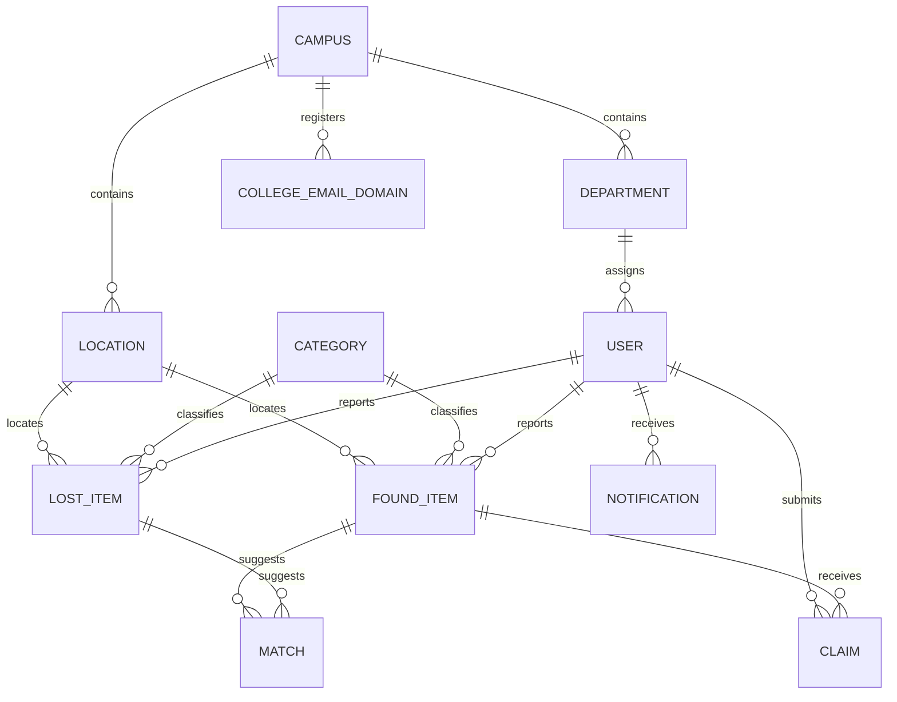

# DBMS syllabus mapping and normalization

Current implementation: 28 October 2026. The selected paradigms are **MySQL relational data + MongoDB document data**. Features below refer to actual source and executable queries; graph/vector systems are not claimed.

## Unit 1: DBMS, architecture, ER and relational SQL

The recovery desk needs shared, durable and consistent records rather than separate messages. Next.js supplies browser views and backend route handlers; MySQL stores identity and workflow relationships; MongoDB stores variable descriptions and evidence. API/session guards restrict each role's view of data.

USER roles constrain operations: only Students create reports/claims; Staff process their college's operations; Admin registers colleges/accounts and supervises. ER one-to-many relationships become foreign keys in the child relation. The domain relation is `COLLEGE_EMAIL_DOMAIN(domain_name PK, campus_id FK, account_type, local_part_format, UNIQUE(campus_id,account_type))`. USER uses DEPARTMENT to derive its campus; a duplicate campus_id is deliberately not stored in USER.

Examples: `WHERE status='OPEN'` is relational selection; selecting item_name/lost_id is projection; report/category/location joins implement relational join. UNION ALL in syllabus-demo.sql combines compatible report projections; UNION ALL preserves bag multiplicity. GROUP BY, COUNT, SUM and recovery percentages aggregate operational records. NOT NULL, PK/FK, UNIQUE, CHECK and RESTRICT rules enforce valid identities and relationships. `NULLIF` prevents division by zero; LEFT JOIN preserves users with optional legacy department data where appropriate.

## Unit 2: advanced SQL in the actual application

| Concept | Implemented use |
|---|---|
| INSERT/UPDATE/DELETE | Student-owned report lifecycle; account provisioning; guarded deletion without history |
| Nested/correlated subqueries | Dashboard counts and NOT EXISTS for unpaired lost reports |
| JOIN | Identity -> department -> registered campus/domain, report/category/location, candidate/claimant |
| Views | Existing per-user/recovery views; new vw_campus_recovery_dashboard and vw_ranked_match_candidates |
| Triggers | Existing reviewer/processor role guards and future-date validation |
| Function | fn_match_band explains HIGH/POSSIBLE/LOW score bands |
| Procedures | sp_review_match and sp_process_claim atomically validate and decide matches/returns |
| CTE | Candidate view's WITH candidates AS (...) defines the pending comparison relation |
| Window function | ROW_NUMBER partitions by lost_id and orders by score then match_id for deterministic candidate ranks |
| SQL full-text search | FULLTEXT(item_name,description,brand) and MATCH ... AGAINST, selectable in report search |
| Set operations | UNION ALL report projections, preserving bag multiplicity |

Sources: [syllabus-features.sql](../../database/mysql/syllabus-features.sql), [syllabus-demo.sql](../../database/mysql/syllabus-demo.sql), [existing queries](../../database/mysql/queries.sql), [procedures](../../database/mysql/procedures.sql). Full-text search uses natural language mode, so MySQL token lengths and stopwords apply; substring search remains available for partial names and short words. Window ranks are calculated within each lost report and do not indicate verified ownership.

## Unit 3: dependencies, normal forms and query optimization

Functional dependencies are semantic rules, not observations from a small dataset:

| Relation | Candidate keys / important dependencies |
|---|---|
| USER | user_id and non-null unique email each determine identity, role, department and authentication state |
| DEPARTMENT | department_id -> department_name, campus_id |
| CAMPUS | campus_id -> campus/address, institution_code, registration_enabled |
| LOCATION | location_id -> location details, campus_id; a name such as Library is not globally unique |
| COLLEGE_EMAIL_DOMAIN | domain_name -> campus_id, account_type, local_part_format; (campus_id,account_type) -> domain_name, local_part_format |
| LOST_ITEM / FOUND_ITEM | respective primary ID -> facts, reporter, category, location, revision and state |
| MATCH | match_id and UNIQUE(lost_id,found_id) each determine score/method/review/version snapshots |
| CLAIM | claim_id and UNIQUE(submitted_by,found_id) each determine proof/status/processing details |
| NOTIFICATION | notification_id -> recipient, message, type and read state |

Armstrong's reflexivity, augmentation and transitivity apply. For example, USER.user_id -> department_id and DEPARTMENT.department_id -> campus_id derive user_id -> campus_id across the join. Storing campus_name and campus address in every USER row would introduce update anomalies, so those facts remain in CAMPUS. Domain registration is a separate relation rather than three repeated columns per account.

- **1NF:** Relational cells contain scalar values with one row per fact. Repeating media/tags/variable attributes are represented by the document model, not comma-separated relational columns.
- **2NF:** Non-key report and claim facts depend on their complete candidate keys. The composite domain alternative key (campus_id,account_type) determines the complete domain assignment; neither component alone does.
- **3NF:** Campus/category/location names are not duplicated into reports; a department's campus data is not copied into USER. Non-key descriptive facts remain with their determining entity.
- **BCNF:** Under the documented dependencies, determinants in the core domain relations are candidate keys. The domain registration relation has two candidate keys and both determinants are keys. Generated nullable accepted/approved IDs enforce conditional success uniqueness; they are not described as ordinary non-null candidate keys.
- **Higher forms:** No independent multi-valued fact sets are combined as a Cartesian product in a relational row set. If future features introduce independent StudentSkill and StudentLanguage facts, store them separately for 4NF. No blanket formal 4NF/5NF proof is claimed for hypothetical future dependencies. MongoDB collections are not claimed to be relational normal forms.

Nullable legacy department values and generated nullable success guards follow SQL semantics; the pure relational dependency analysis applies to the stated non-null keys and current account provisioning rules.

Optimization is demonstrated with real EXPLAIN output in the integration evidence. Unique USER.email drives login lookup; primary/FK and unique college-role indexes support subsequent joins. Owner/status/time indexes support report lists; full-text indexes support word search; per-document outbox indexes support ordered recovery. Prepared parameters preserve query structure. Filters are applied before fetching bounded result sets (500 reports; 2000 candidate comparisons). The optimizer remains free to choose a scan on tiny datasets; no performance improvement is invented from index existence alone.

## Unit 4: transactions, concurrency and document storage

Report/account creation and their outbox events commit in MySQL transactions. Match/claim procedures lock related rows consistently and roll back invalid/stale/conflicting decisions. Generated unique success guards prevent multiple accepted pairs or approved owners. Concurrent live tests assert one committed winner. Login lock state and credential-version revocation persist in SQL.

MongoDB stores lost_item_details, found_item_details, match_evidence and audit_events with strict validators and unique stable link indexes. Lookup by lost_id/found_id/match_id demonstrates keyed document retrieval; $match/$group/$unwind pipelines demonstrate document aggregation. This is a document database application, not a claimed Redis/key-value deployment. No graph database or embeddings/vector index is used: these are syllabus alternatives, while this project deliberately selects SQL + NoSQL and an explainable rule-based matcher.

The transactional outbox provides eventual consistency across two stores. MySQL and MongoDB do not share one distributed transaction. A worker uses a named SQL lock, per-document ordering, stable idempotent upserts, backoff and retained failure payloads. The fault suite checks lost acknowledgement, worker restart, simultaneous workers, Mongo outage and manual recovery. Audit events are stored in MongoDB after durable SQL enqueue; no plaintext passwords/hashes enter them.

Primary references: [MySQL window functions](https://dev.mysql.com/doc/refman/8.0/en/window-functions.html), [MySQL full-text search](https://dev.mysql.com/doc/refman/8.0/en/fulltext-natural-language.html). Actual source, test results and query plans are the evidence for this repository.
