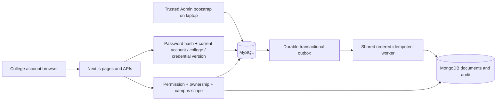

# Current architecture — college accounts

Updated 28 October 2026. Next.js routes and server pages enforce college-email/password authentication and Student/Staff/Admin permissions. Google OAuth and passwordless demo authentication are retired.

MySQL holds 13 base tables: ten original domain tables, COLLEGE_EMAIL_DOMAIN, MONGO_OUTBOX and SCHEMA_MIGRATION. It stores user credentials only as salted hashes. College domains and configurable email ID templates are normalized into one relation with domain PK and (campus,account_type) uniqueness. The Admin registers the college policy; there is no fixed institutional username convention. USER's campus derives through DEPARTMENT, avoiding a transitive duplicate field.

Students submit both lost/found reports and claims. Staff review reports in their own registered college, generate/review matches and process claims. Admin registers colleges, provisions Student/Staff accounts, manages master data, inspects audit/sync and supervises operations. Admin creation exists only in the trusted CLI; no role selector or web API can produce an Admin. A college/account disable or credential update invalidates old session versions.

MongoDB remains the document read model for flexible item details, comparison snapshots and audit events. MySQL holds authoritative workflow state and durable document events; the two stores do not form one atomic transaction. The shared worker retains payloads until Mongo acknowledgement, orders writes per document, uses stable identifiers and bounded backoff, and distinguishes permanent/exhausted failures. Matching can use relevant committed recovery snapshots during a Mongo outage; absent legacy snapshots still require Mongo connectivity.

Report plus detail/audit events commit in one SQL transaction. Stored procedures lock reports/candidates/claims, check current revisions and states, enforce a single accepted/approved outcome, and commit notifications/audit enqueue atomically. OPEN reports can be edited by their Student owner; accepted matches mark reports MATCHED; approved ownership closes both. Terminal decisions remain immutable through APIs.

Four views serve user, global recovery, college recovery and CTE/window candidate ranking. MySQL full-text indexes support word search; substring search remains available. Existing eight role/date triggers, two procedures and one function remain installed. MongoDB still has four validated/indexed collections; no graph/vector service was introduced. See [syllabus mapping](../design/Syllabus_Mapping.md) and [authentication](Authentication.md).
