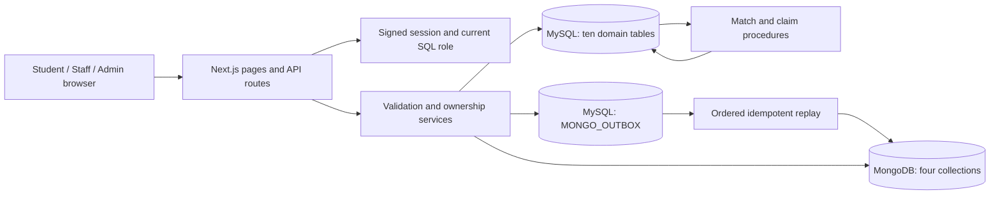
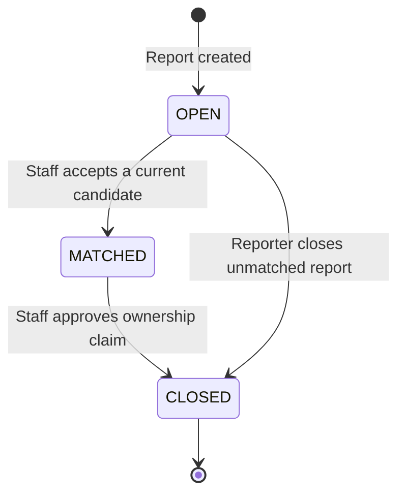

# Application architecture

The browser uses Next.js server pages and JSON route handlers. Zod validates request bodies; session middleware checks mutation origins; services enforce role and record ownership. MySQL holds identity, reference data and recovery state. MongoDB holds variable item descriptions, matching explanations and audit events.

## Recovery state

Matches move from PENDING to ACCEPTED or REJECTED. Claims move from PENDING to APPROVED or REJECTED. Terminal decisions are immutable in the application. Rejection of a claim leaves the pair matched for staff follow-up; duplicate claims from the same person for the same found item remain blocked.

## SQL transaction boundary

`sp_review_match` locks the lost report, found report and candidate in that order. It checks the actor's role, OPEN states and stored report revisions. Acceptance updates both reports, rejects competing candidates and creates a student notification before COMMIT. Unique generated columns also prevent two accepted pairs sharing a report.

`sp_process_claim` follows the same lock order. It checks the accepted match and claimant, prevents self-processing, approves the claim, closes both reports and commits the collection notification together. SQL exceptions trigger ROLLBACK.

## Cross-database consistency

The report transaction commits its core row and a JSON payload in MONGO_OUTBOX together. A worker holds a MySQL named lock, processes rows in ID order and performs idempotent MongoDB upserts/deletes. Only successful writes receive processed_at. Failures retain the payload, increment attempts and record an error for retry.

This is eventual consistency, not a distributed transaction. Report responses expose whether enrichment was saved; staff can retry from the dashboard or `npm run db:sync`. Matching refuses to generate while unsynchronized detail writes remain. Audit events use a separate best-effort write; they are not guaranteed during a MongoDB outage.

## Security and operational choices

- MySQL queries use parameters; editable field names come from fixed allowlists.
- Cookies are signed with HS256, HttpOnly and SameSite=Lax; production Google cookies use HTTPS security settings. Role and account existence are checked against SQL on each request.
- Students see their own lost reports, matches and claims. Found-item private attributes and remarks are restricted to the reporter and staff/admin.
- Only staff/admin generate matches, review candidates and process claims. Only admin registers users.
- SQL foreign keys, unique keys, CHECKs and triggers reinforce API checks. MongoDB uses strict JSON schema validation and unique SQL-link indexes.
- API input timestamps carry an offset and are stored in UTC; UI renders Asia/Kolkata. IDs are immutable and foreign keys use RESTRICT.
- API lists are capped at 500 records; matching stops above 2,000 eligible comparisons and can be restricted to a specific lost report.

Implementation entry points: `lib/report-service.ts`, `lib/match-service.ts`, `lib/claim-service.ts`, `lib/outbox.ts`, `database/mysql/procedures.sql`, and `database/mongodb/model.mjs`.

## Final inventory and conceptual design

The verified schema has 10 domain tables, MONGO_OUTBOX and SCHEMA_MIGRATION, 2 views, 2 procedures, 1 function and 8 triggers; MongoDB has 4 collections. SCHEMA_MIGRATION belongs to setup infrastructure and is outside request flows. The unchanged conceptual ER predates queue/migration, revision and generated uniqueness additions; the final relational schema and dictionary document these explicitly. Migration checksums are stored but not compared during repeat setup. Revisions are incremented by application edits, not SQL triggers.

## Configured storage verified on 12 October 2026

The running installation currently reads relational records from configured MySQL and flexible details/evidence/activity from configured MongoDB Atlas. The previously local MongoDB documents were restored to Atlas with explicit approval while retaining both originals and existing target documents. Runtime report lists/dashboards use SQL queries; report details and match explanations use MongoDB queries. Seed files initialize databases; testing JSON files do not feed the interface. See [database-storage evidence](../testing/results/database-storage.json).
